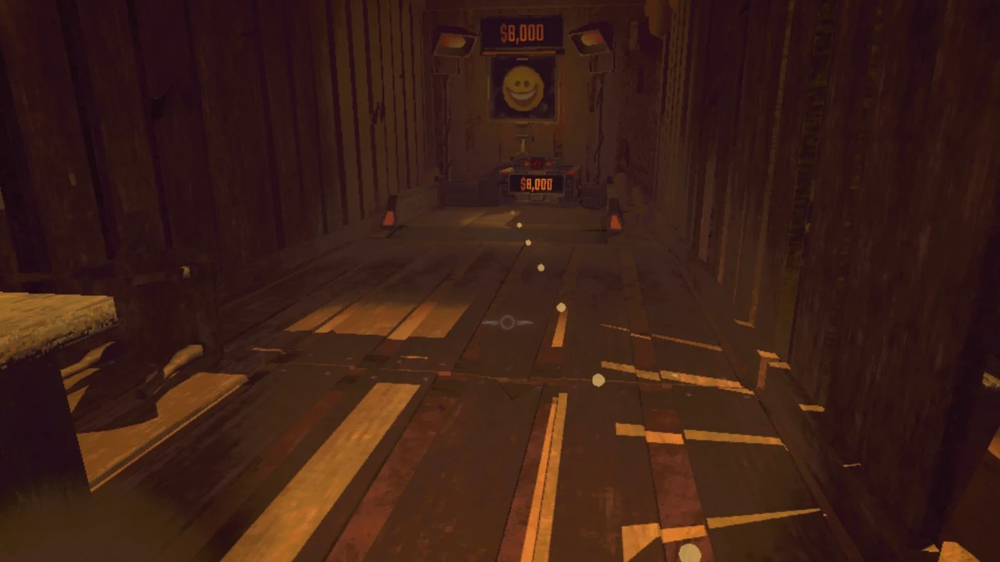
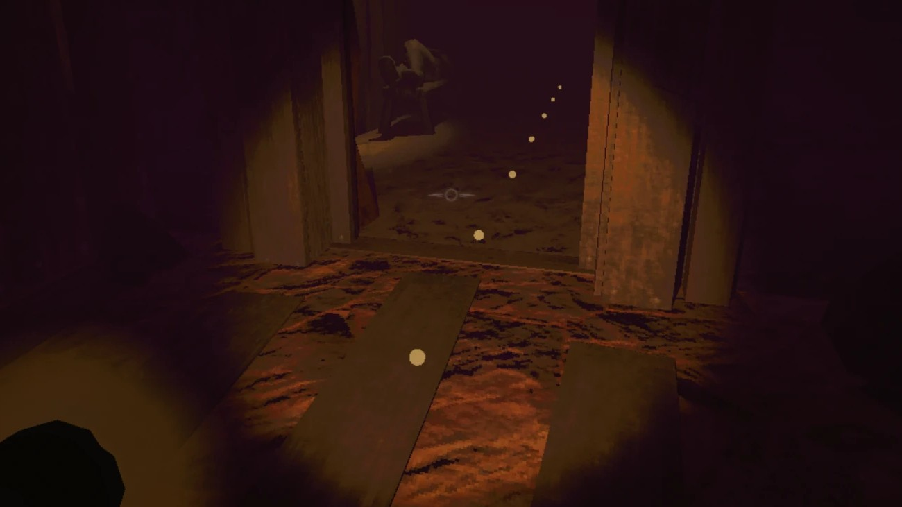
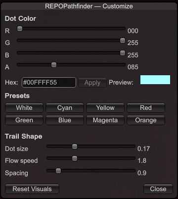

<!-- github-only:start -->
<a href="https://thunderstore.io/c/repo/p/MentalizePez/REPOPathfinder/"></a>
<!-- github-only:end -->

A BepInEx plugin for R.E.P.O. that draws a dot trail on the floor along the walkable path to the current extraction point, or back to the truck once every extraction is done. It reads the same game state the dots on the in-game map follow, and draws the route in the world so you can follow it without opening the map.

<!-- github-only:start -->
**Live release:** [thunderstore.io/c/repo/p/MentalizePez/REPOPathfinder](https://thunderstore.io/c/repo/p/MentalizePez/REPOPathfinder/) — published under the shared author handle MentalizePez (Mentalize + Pez), install via Thunderstore Mod Manager or by dropping the DLL into BepInEx (see [Install](#install)).
<!-- github-only:end -->

Hotkeys (configurable, all default to F-keys):

- **F4** — toggle the trail on / off.
- **F5** — switch the destination between **Auto** (current extraction, or the truck when all are complete) and **Truck** (always the truck, for going back to charge items mid-run). The choice is saved.
- **F6** — open the customization panel: RGBA color sliders, hex input, color presets, and live sliders for dot size / flow speed / spacing. **Esc** or F6 closes it. Changes are saved to the BepInEx config.

While you are dead, the trail starts from the player you are spectating.





<!-- github-only:start -->
## Approach, tools, and assumptions

**Approach.** The in-game map already has dot guidance to the current extraction point; this plugin reads the same game state and draws its own route in world space. The interesting design question was *how* to do that without the dots jittering every time the player moved — the naive approach (recompute the NavMesh path from the player to the target every 250 ms and re-render dots in arc-distance from the player) translates the entire trail forward in one frame at every recompute. The shipped design instead caches the path corners in absolute world coordinates and each frame projects the player onto that cached polyline to find a `playerArc` scalar. Dots are placed at world positions derived from the cached corners; walking forward changes only `playerArc`, never the dots' world positions. Recompute fires only when the target changes or when the player drifts past a configurable distance from the cached path. See [Path computation](#path-computation) for the math.

The route is the plugin's own: the map's dots use a different point at the truck and do not show in the shop, so the two can differ slightly.

**Tools.**
- C# / .NET Standard 2.1, BepInEx 5.4.2100 (Mono build — not IL2CPP).
- HarmonyX 2.10, used only for its typed field accessors (`AccessTools.FieldRefAccess`). Nothing is patched: not the game, not Unity.
- Unity 2022.3.21 modules (compile-only references via `UnityEngine.Modules` NuGet). The game itself now runs on Unity 6000.3; every Unity member the plugin calls exists in both.
- Unity `NavMesh.CalculatePath` for path queries, IMGUI for the customization overlay, `MaterialPropertyBlock` for per-dot color/alpha without per-dot material allocations.
- Build via `dotnet build -c Release`; `python tools/make_package.py` builds the Thunderstore zip.

**Assumptions.**
- REPO is Mono-BepInEx, so the game's `internal` fields (`PlayerAvatar.LastNavmeshPosition`, `RoundDirector.extractionPointCurrent`, `RoundDirector.allExtractionPointsCompleted`, and for spectating `PlayerAvatar.isDisabled`, `PlayerAvatar.deadSet`, `SpectateCamera.player`) can be read at runtime. They are bound once at startup; if a game update removes one, the log names it.
- REPO's NavMesh is baked per level; the plugin calls `NavMesh.CalculatePath` for its own visualization but never bakes or modifies the NavMesh.
- The mod is purely client-side: each player reads the shared game state independently and renders only their own dots — no RPCs, no Photon traffic.
<!-- github-only:end -->

## What the DLL actually does

On plugin `Awake()`, it:

- **Reads its config.** A standard BepInEx config file (`BepInEx/config/isaia.repopathfinder.cfg`) defines all hotkeys, dot visuals, animation tunables, and the path-recompute threshold. A `[Internal] ConfigVersion` key migrates stale defaults from prior versions in place — values that exactly match a previous default get overwritten with the current default; user-customized values are left alone. The file is written once at startup and once each time the F6 panel closes.
- **Binds the game fields it reads.** If the three the trail cannot work without are missing (a game update renamed them), one error line names them, the trail stays off, and F4 shows "needs an update for this game version".
- **Creates a `DontDestroyOnLoad` `GameObject`.** Adds two `MonoBehaviour`s to it: `PathfinderManager` (path / animation / rendering) and `PathfinderCustomizeUI` (the F6 IMGUI overlay).

It installs no Harmony patches. If drawing the trail throws, the error is logged once; after 5 failed frames in a row the trail turns itself off until you press F4 again.

## Path computation

The path is **cached** in world space, not recomputed every frame:

1. **Target.** Truck mode: `LevelGenerator.LevelPathTruck`. Auto mode: `RoundDirector.extractionPointCurrent`, or the truck once `RoundDirector.allExtractionPointsCompleted` is set. The target point is moved onto the NavMesh (up to 4 m) before the search.
2. **Start.** `PlayerAvatar.LastNavmeshPosition`; if that is more than 10 m from the player (stale), the player's own position moved onto the NavMesh. While dead: the spectated player's position, or no trail when nobody is being spectated.
3. **Recompute trigger.** A new path is computed only when:
   - There is no cached path yet,
   - The target changed (different extraction, Auto↔Truck, or a new level), or
   - The player has drifted further than `OffPathRecomputeThresholdMeters` (default `3.0`) from the cached polyline.

   Searches are at least 0.2 s apart, and 0.75 s apart after one that found nothing.
4. **Compute & cache.** `NavMesh.CalculatePath` is called once. The corners and prefix arc-distances are stored; the displayed dots reference these stable world-space points for as long as the cache lives. When only a partial route exists, the trail shows it and a short notice says so. Each new target logs one line (`Path to <name>: <status>, <n> corners, <m> m.`).
5. **Each frame.** The player is projected onto the cached polyline to produce a `playerArc` scalar; that's the trail's "back end". Walking forward changes only `playerArc`; the cached corners are untouched, so dot world positions stay stable regardless of how the player moves.

## Animation & rendering

- A pool of `MaxDots` (default 30) sphere primitives, colliders stripped, sharing one material with per-dot color set via `MaterialPropertyBlock`.
- A single shared `_animOffset` ∈ [0, spacing) advances by `FlowSpeed` m/s. When it crosses `spacing` the circular pool pointer `_frontPool` decrements, which makes every sphere's slot index increment by 1 simultaneously. Spacing stays perfectly even regardless of how `availableLength = totalLength - playerArc` changes.
- The single sphere whose slot wraps from `MaxDots-1` to `0` per cycle has its smoothing flag cleared in the same step, so it snaps to its new position at the player end of the trail instead of being lerped across the room.
- World position per dot: `CachedPointAtDistance(playerArc + slot*spacing + animOffset)`, plus `GroundOffset` on Y. The result is exponentially smoothed toward the displayed position with rate `PositionSmoothRate` (default `25` 1/s) for the rare cases where the path is re-cached.
- Alpha fade per dot: `min(SmoothStep(0..fadeZone, d), SmoothStep(0..fadeZone, endpoint-d))` where `d = slot*spacing + animOffset`, `endpoint = min(availableLength, activeCount*spacing)` and `fadeZone = max(0.05, min(spacing, endpoint/2) * FadeZoneFraction)`. Hides the wrap and the path's own ends behind alpha-0 transitions.
- The material's shader is the first of `Sprites/Default`, `Unlit/Color`, `Hidden/Internal-Colored`, `Standard` that the game build contains (a warning is logged if none is). `_ZWrite` 0 and `SrcAlpha`/`OneMinusSrcAlpha` blend are set if the chosen shader exposes those properties; render queue is `3500`.

## Customization UI

`PathfinderCustomizeUI` (default F6) is a draggable `GUILayout.Window`:



- RGBA sliders (0–255 readout), `#RRGGBBAA` text field with **Apply**, preview swatch over a white underlay so transparency is obvious, eight color presets.
- Sliders for `DotScale`, `FlowSpeedMetersPerSec`, `SpacingMeters`.
- **Reset Visuals** writes each of the above ConfigEntries back to its `DefaultValue`. **Close**, F6 or Esc dismisses the panel.
- Edits go straight to the BepInEx ConfigEntries, so the dots in the world update while you drag. The config file itself is written when the panel closes.
- While the panel is open the game's controls are held still with the game's own switches (`InputManager.DisableMovement`, `DisableAiming`, `DisableControlsExcept`) and the cursor is freed with `CursorManager.Unlock`, the same calls the game's menus use. You cannot walk, look, grab or open the pause menu until it closes; push-to-talk keeps working. The hold lasts a quarter of a second past the last frame the panel was open, so the click or key that closed it does not reach the game.

## Install

Install with a mod manager, or by hand: drop `REPOPathfinder.dll` into `<profile>/BepInEx/plugins/REPOPathfinder/`. Requires `BepInEx-BepInExPack`.

<!-- github-only:start -->
Thunderstore Mod Manager: open the [live release](https://thunderstore.io/c/repo/p/MentalizePez/REPOPathfinder/) and click Install.

## Building from source

**Prerequisites.**
- .NET SDK 6.0 or newer (verify with `dotnet --version`).
- A local R.E.P.O. install. The csproj defaults to `C:\Program Files (x86)\Steam\steamapps\common\REPO` for its `Assembly-CSharp.dll` reference; override on the build command line with `-p:REPOPath="<your install root>"` if your install lives elsewhere.

**Build.**

```
dotnet build -c Release
```

**Output.**
- `bin/Release/netstandard2.1/REPOPathfinder.dll` — the plugin binary. Its version comes from `version_number` in `manifest.json`.

`python tools/make_package.py` builds the DLL and writes the Thunderstore zip to `dist/`. The README inside that zip leaves out the parts of this file marked `github-only`: the download card, the links to the Thunderstore page, and the sections on approach, building from source and the license.

To run locally: drop the DLL into `<BepInEx profile>/BepInEx/plugins/REPOPathfinder/` and launch the game. To publish: upload the zip via the Thunderstore web uploader.
<!-- github-only:end -->

## Compatibility

- **Checked against** R.E.P.O. v0.5.3 (Unity 6) with BepInEx 5.4.23.
- **Client-side.** The plugin is purely local: it reads `PlayerController.instance.playerAvatarScript`, `RoundDirector.instance`, `LevelGenerator.Instance` and `SpectateCamera.instance` to compute its own path and renders its own GameObjects. No RPCs, no Photon traffic. Each player can install independently; nothing about the plugin requires the host or other clients to have it.
- **No Harmony patches.** The game's `internal` fields are read through typed accessors; nothing in the game or in Unity is patched. The F6 panel uses the game's public input and cursor switches, so it does not conflict with mods that patch input.
- **No NavMesh modifications.** The plugin calls `NavMesh.CalculatePath` for itself; it does not bake or alter the game's NavMesh.

## Changelog

### 0.7.3
- Checked against the current game (R.E.P.O. v0.5.3, Unity 6).
- The F6 panel now holds the game's controls with the game's own input switches: no walking, looking, grabbing or pause menu while it is open, and Esc closes it. The Unity input patches from 0.7.2 are gone; the plugin no longer patches anything.
- While you are dead, the trail starts from the player you are spectating.
- When no full route exists, the trail shows the closest one and says so. The target is moved onto the walkable area, so an extraction point slightly off the NavMesh still gets a trail.
- The cached route is dropped when the level changes, and lowering `MaxDots` hides the extra dots straight away.
- If a game update removes something the plugin reads, the log names it and F4 says the mod needs an update. Repeated errors turn the trail off instead of logging every frame.
- The config file is written once at startup and when the panel closes. Six trail settings now have ranges.

Every version is in [CHANGELOG.md](CHANGELOG.md).

## Credits

REPOPathfinder is built by two developers:

- **Mentalize** ([IsaiahAnson](https://github.com/IsaiahAnson)), co-developer
- **Pez** ([KaydenceComalander](https://github.com/KaydenceComalander)), co-developer and tester.

The Thunderstore release is published under their shared handle, MentalizePez.

<!-- github-only:start -->
## License

Copyright (c) 2026 Isaiah Anson and KaydenceComalander (Pez). All rights reserved. You may use the released software for
personal, non-commercial use; copying, modifying or redistributing it requires written
permission. See [LICENSE](LICENSE).
<!-- github-only:end -->
